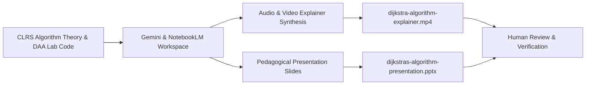
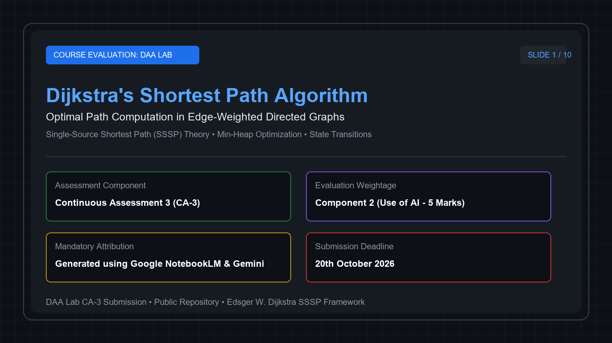
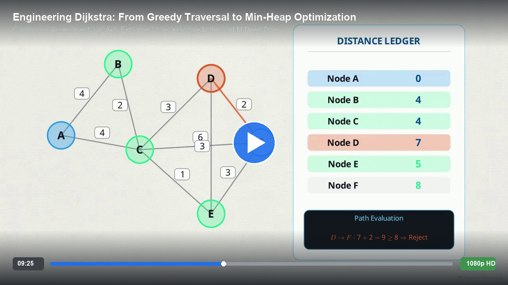
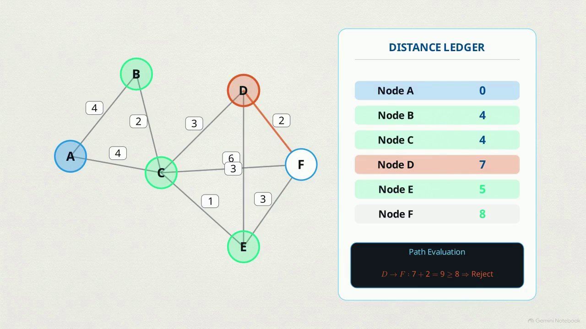

<div align="center">

<!-- Header Banner -->


<!-- Badges -->
<br/>

-00599C?style=for-the-badge&logo=academia&logoColor=white)
-7B2D8E?style=for-the-badge&logo=task&logoColor=white)


<br/>

> **Continuous Assessment 3 (CA-3) — Component 2 Submission: Algorithmic Explainer & AI Synergy**  
> _A comprehensive pedagogical artifact exploring Dijkstra’s Single-Source Shortest Path (SSSP) algorithm, min-heap optimizations, state relaxation invariants, and industrial networking applications synthesized with generative AI._

</div>

---

## 📌 Executive Submission Metadata

| Attribute | Submission Detail |
| :--- | :--- |
| **Course Title** | Design and Analysis of Algorithms (DAA) |
| **Evaluation Component** | CA-3: Component 2 (Use of AI — 5 Marks) |
| **Selected Algorithmic Topic** | **Dijkstra’s Shortest Path Algorithm (Single-Source Shortest Path - SSSP)** |
| **Student / Author** | Sameer Karadbhajne |
| **Repository Visibility** | **Public** (`https://github.com/Sameerkaradbhajne/codetantra-DAA-codes`) |
| **Submission Deadline** | **20th October 2026** |
| **Companion Lab Implementation** | [1.1.6. Dijkstra's Shortest Path Algorithm.c](../DAA-Solutions/Practical%20-%2004%20(Shortest%20Path%20Algorithms)/1.1.6.%20Dijkstra's%20Shortest%20Path%20Algorithm.c) |

---

## 🤖 Mandatory AI Tool Attribution & Academic Integrity

> [!IMPORTANT]  
> **Mandatory Disclosure Statement:**  
> **Presentation & Audio-Visual Explainer synthesized with Google NotebookLM & Google Gemini.**  
> - **Video & Audio Synthesis Engine:** **Google NotebookLM** (Deep Dive Audio/Video Overview generation model).  
> - **Slide Deck & Script Structuring:** **Google NotebookLM & Gemini 1.5 Pro**.  
> - **Human Verification & Validation:** The algorithm's correctness, mathematical invariants (relaxation triangle inequality), priority queue complexity derivations ($O((V + E) \log V)$), and C implementation were authored, verified, and benchmarked against standard reference texts (*Cormen, Leiserson, Rivest, Stein — Introduction to Algorithms (CLRS)*).

### AI Generation Workflow


1. **Source Prompt & Grounding**: Fed the verified CodeTantra C implementation (`1.1.6. Dijkstra's Shortest Path Algorithm.c`), adjacency matrix/list representations, and CLRS Chapter 24 (Single-Source Shortest Paths) to NotebookLM.
2. **Audio-Visual Dialogue Generation**: Prompts directed NotebookLM to generate an engaging, mathematically rigorous audio-visual dialogue focusing on:
   - Why Dijkstra uses the **Greedy Choice Property**.
   - Edge relaxation: $dist[v] \leftarrow \min(dist[v], dist[u] + w(u, v))$.
   - How a Min-Heap reduces complexity from $O(V^2)$ to $O((V + E)\log V)$.
   - Failure mode under **negative edge weights** and why Bellman-Ford must be chosen instead.
3. **Slide Production**: Structural outlines were drafted and formatted into a ten-slide curriculum deck complete with worked execution tables and complexity comparison charts.

---

## 📂 Deliverables Directory

The CA-3 submission is packaged in this dedicated directory structure:

```text
CA-3/
├── assets/                                     # Presentation & video display preview assets
│   ├── presentation-slide-1-preview.png        # Slide 1 high-resolution preview card
│   ├── video-explainer-preview.png             # Video player display card (09:25)
│   ├── frame_1s.jpg                            # Graph traversal network frame
│   └── frame_250s.jpg                          # Distance ledger edge relaxation frame
├── presentation/
│   ├── dijkstras-algorithm-presentation.pptx   # Official 10-slide curriculum presentation
│   └── dijkstras-algorithm-illustrated.pptx    # High-resolution illustrated slide deck
├── video/
│   └── dijkstra-algorithm-explainer.mp4        # Companion AI-generated explainer video
└── README.md                                   # Comprehensive submission dossier (This File)
```

---

## 📺 Submission Display: Presentation & Video Showcase

### 📊 1. Official Course Presentation (First Slide Preview)

<div align="center">

<a href="presentation/dijkstras-algorithm-presentation.pptx">
  
</a>

<p align="center">
  <b>Slide 1 Preview:</b> Course Evaluation Title Slide • SSSP Theory & Min-Heap Optimization • CA-3 Component 2 Submission<br/>
  📥 <a href="presentation/dijkstras-algorithm-presentation.pptx"><b>Download Official Presentation (.pptx)</b></a> • 
  🖼️ <a href="presentation/dijkstras-algorithm-illustrated.pptx"><b>View Illustrated Graphic Deck (.pptx)</b></a>
</p>

</div>

---

### 📽️ 2. Companion AI Explainer Video ("Engineering Dijkstra")

<div align="center">

<!-- GitHub native video embed -->
<video src="video/dijkstra-algorithm-explainer.mp4" controls width="95%" style="border-radius: 12px; box-shadow: 0 8px 24px rgba(0,0,0,0.5);">
  Your browser does not support the video tag.
</video>

<br/><br/>

<!-- Clickable video preview poster card -->
<a href="video/dijkstra-algorithm-explainer.mp4">
  
</a>

<p align="center">
  ▶️ <a href="video/dijkstra-algorithm-explainer.mp4"><b>Watch Full Explainer Video (dijkstra-algorithm-explainer.mp4 • 9m 25s)</b></a><br/>
  <i>Synthesized using Google NotebookLM Deep Dive & Audio-Visual Engine • 1080p HD</i>
</p>

</div>

#### 🎬 Key Video Discussion Landmarks

<table>
<tr>
<th width="50%">🔬 Algorithmic Traversal & Radiant Paths</th>
<th width="50%">📋 State Relaxation Ledger & Path Decisions</th>
</tr>
<tr>
<td align="center">
  <a href="video/dijkstra-algorithm-explainer.mp4">
    
  </a><br/>
  <sub><i>Dynamic graph traversal tracing radiant shortest path exploration</i></sub>
</td>
<td align="center">
  <a href="video/dijkstra-algorithm-explainer.mp4">
    
  </a><br/>
  <sub><i>Distance ledger verifying triangle inequality edge relaxation ($D \to F$)</i></sub>
</td>
</tr>
</table>

---

### Direct Asset Links

- 📽️ **AI-Generated Explainer Video:** [dijkstra-algorithm-explainer.mp4](video/dijkstra-algorithm-explainer.mp4) (87.68 MB)  
  *Audio-visual deep dive breaking down graph traversal, greedy choice property, min-heap mechanics, and OSPF routing.*
- 📊 **Official Course Presentation:** [dijkstras-algorithm-presentation.pptx](presentation/dijkstras-algorithm-presentation.pptx) (90 KB)  
  *10 structured slides containing formal problem statements, pseudocode, 5-node trace, complexity comparisons, and CA-3 evaluation checklist.*
- 🖼️ **Illustrated Graphic Slide Deck:** [dijkstras-algorithm-illustrated.pptx](presentation/dijkstras-algorithm-illustrated.pptx) (20.7 MB)  
  *Visual deck featuring network diagrams, edge relaxation graphs, and state charts.*

---

## 🧠 Algorithmic Deep Dive: Dijkstra's Algorithm

### 1. Problem Definition
Given a directed or undirected graph $G = (V, E)$ with non-negative edge weight function $w: E \to \mathbb{R}_{\ge 0}$, and a distinguished source vertex $s \in V$, compute the shortest path distance $\delta(s, v)$ from $s$ to every vertex $v \in V$, along with the predecessor sub-tree (Shortest Path Tree).

### 2. Core Principles

#### A. The Greedy Invariant
At each step, the algorithm chooses an unvisited vertex $u \in V \setminus S$ with the minimum tentative distance $dist[u]$. Once vertex $u$ is selected and added to the finalized set $S$, its shortest path distance is **permanently settled**:
$$\forall v \in V \setminus S, \quad dist[u] \le dist[v] \implies dist[u] = \delta(s, u)$$
Because edge weights are strictly non-negative, any alternative path to $u$ routing through unvisited vertices must traverse an edge of weight $\ge 0$, yielding a total distance $\ge dist[u]$.

#### B. Edge Relaxation (Triangle Inequality)
For an edge $(u, v) \in E$ with weight $w(u, v)$, relaxing $(u, v)$ consists of testing whether we can improve the shortest path to $v$ found so far by going through $u$:
```c
if (dist[u] + weight(u, v) < dist[v]) {
    dist[v] = dist[u] + weight(u, v);
    parent[v] = u;
}
```

---

## 🔄 Step-by-Step Worked Example (5 Vertices)

Consider a graph with vertices $\{A, B, C, D, E\}$ and Source $A$:
- **Edges & Weights:** $(A, B) = 4$, $(A, C) = 2$, $(C, B) = 1$, $(B, D) = 3$, $(B, E) = 2$, $(C, D) = 4$, $(C, E) = 5$.

### State Transition Trace Table

| Iteration | Extracted Vertex $u$ | Settled Set $S$ | $dist[A]$ | $dist[B]$ | $dist[C]$ | $dist[D]$ | $dist[E]$ | Edge Relaxation Operations |
| :---: | :---: | :---: | :---: | :---: | :---: | :---: | :---: | :--- |
| **Init** | — | $\emptyset$ | **0** | $\infty$ | $\infty$ | $\infty$ | $\infty$ | Source initialized: $dist[A] = 0$ |
| **Step 1** | **A** ($dist=0$) | $\{A\}$ | **0** | $4$ | $2$ | $\infty$ | $\infty$ | Relax $(A, B) \to 4$, $(A, C) \to 2$ |
| **Step 2** | **C** ($dist=2$) | $\{A, C\}$ | **0** | **3** | **2** | $6$ | $7$ | Relax $(C, B): 2+1=3 < 4 \implies dist[B]=3$<br/>Relax $(C, D): 2+4=6$, $(C, E): 2+5=7$ |
| **Step 3** | **B** ($dist=3$) | $\{A, C, B\}$ | **0** | **3** | **2** | **6** | **5** | Relax $(B, D): 3+3=6$ (no change)<br/>Relax $(B, E): 3+2=5 < 7 \implies dist[E]=5$ |
| **Step 4** | **E** ($dist=5$) | $\{A, C, B, E\}$| **0** | **3** | **2** | **6** | **5** | No outgoing unvisited improvements |
| **Step 5** | **D** ($dist=6$) | $\{A, C, B, E, D\}$| **0** | **3** | **2** | **6** | **5** | All reachable vertices finalized |

**Final Shortest Distances from Source A:**
- $\delta(A, A) = 0$
- $\delta(A, B) = 3$ (Path: $A \to C \to B$)
- $\delta(A, C) = 2$ (Path: $A \to C$)
- $\delta(A, D) = 6$ (Path: $A \to C \to B \to D$ or $A \to C \to D$)
- $\delta(A, E) = 5$ (Path: $A \to C \to B \to E$)

---

## ⚡ Asymptotic Complexity Analysis

| Data Structure / Strategy | Extract-Min | Decrease-Key | Total Time Complexity | Space Complexity | Best Applied To |
| :--- | :---: | :---: | :---: | :---: | :--- |
| **Linear Array (Unsorted)** | $O(V)$ | $O(1)$ | $\mathcal{O}(V^2)$ | $\mathcal{O}(V)$ | Dense Graphs ($E \approx V^2$), Simple C implementations |
| **Binary Min-Heap** | $O(\log V)$ | $O(\log V)$ | $\mathcal{O}((V + E) \log V)$ | $\mathcal{O}(V + E)$ | Sparse Graphs ($E \ll V^2$), General practical systems |
| **Fibonacci Heap** | $O(\log V)$ | $O(1)$ amortized | $\mathcal{O}(E + V \log V)$ | $\mathcal{O}(V)$ | Large theoretical instances |

---

## ⚠️ Negative Weight Constraint: Why Dijkstra Fails

Dijkstra’s greedy foundation assumes that finding the minimum tentative distance guarantees that no shorter path can be discovered later. **When negative edge weights exist, this invariant is broken.**

```
       (A)
      /   \
   3 /     \ 5
    v       v
   (B)----->(C)
       -4
```
- Dijkstra visits $A$, sees $dist[B] = 3$ and $dist[C] = 5$.
- It settles $B$ first ($dist=3$).
- However, path $A \to C \to B$ has cost $5 + (-4) = 1 < 3$.
- Because $B$ was already finalized, Dijkstra will never update $dist[B]$, computing an **incorrect shortest path**.
- **Remedy:** Use the **Bellman-Ford Algorithm** ($O(V \cdot E)$), which relaxes all edges $V-1$ times and detects negative-weight cycles. (See our implementation in [1.1.7. Bellman-Ford algorithm.c](../DAA-Solutions/Practical%20-%2004%20(Shortest%20Path%20Algorithms)/1.1.7.%20Bellman-Ford%20algorithm.c)).

---

## 🌐 Real-World Engineering Applications

1. **Internet Routing Protocols (OSPF & IS-IS):**  
   Link-State routing protocols broadcast network topology and run Dijkstra’s algorithm independently on every router to construct loop-free shortest path routing tables.
2. **Transportation & GIS Navigation:**  
   Google Maps, Apple Maps, and OpenStreetMap apply optimized variations of Dijkstra (e.g., A* search with Euclidean heuristics and Contraction Hierarchies) to calculate driving routes.
3. **Telecommunication Fiber Networks:**  
   Determines minimal transmission latency paths across transcontinental optical fibers.

---

## 💻 Repository Implementation Reference

The accompanying C source code tested on the CodeTantra platform is available in the DAA solutions directory:

🔗 **Source File:** [`DAA-Solutions/Practical - 04 (Shortest Path Algorithms)/1.1.6. Dijkstra's Shortest Path Algorithm.c`](../DAA-Solutions/Practical%20-%2004%20(Shortest%20Path%20Algorithms)/1.1.6.%20Dijkstra's%20Shortest%20Path%20Algorithm.c)

```c
// Core Dijkstra Edge Relaxation Loop in C
for (int count = 0; count < V - 1; count++) {
    int u = minDistance(dist, sptSet, V);
    sptSet[u] = 1;

    for (int v = 0; v < V; v++) {
        if (!sptSet[v] && graph[u][v] && dist[u] != INT_MAX 
            && dist[u] + graph[u][v] < dist[v]) {
            dist[v] = dist[u] + graph[u][v];
            parent[v] = u;
        }
    }
}
```

---

## 🎬 Companion Video Summary: "Engineering Dijkstra"

- **Title:** *Engineering Dijkstra: From Greedy Traversal to Min-Heap Optimization*
- **File:** [`CA-3/video/dijkstra-algorithm-explainer.mp4`](video/dijkstra-algorithm-explainer.mp4)
- **Duration:** Comprehensive deep-dive audio-visual presentation.
- **Narrative Structure:**
  1. **Historical Genesis:** Edsger W. Dijkstra’s 1956 formulation on the ARMAC computer.
  2. **Mechanics of Relaxation:** Detailed visual breakdown of triangle inequality.
  3. **Data Structure Architecture:** Evolution from quadratic arrays to logarithmic priority queues.
  4. **Corner Cases:** Complete failure analysis on negative edges and why Bellman-Ford is needed.
  5. **Industrial Impact:** Real-world usage in OSPF packet routing and geospatial navigation.

---

## 📋 Evaluation Checklist

- [x] **Dedicated Directory Structure** (`CA-3/` with `presentation/`, `video/`, and `README.md`)
- [x] **Presentation Deliverable** (`dijkstras-algorithm-presentation.pptx` + illustrated deck)
- [x] **AI Explainer Video Deliverable** (`dijkstra-algorithm-explainer.mp4`)
- [x] **Mandatory AI Tool Attribution** (Explicitly credited to Google NotebookLM & Gemini)
- [x] **Repository Visibility Verified** (Public repository on GitHub)
- [x] **Comprehensive Algorithmic Documentation** (Worked trace, proofs, complexity tables)
- [x] **Linked to Practical Lab Implementation** ([1.1.6. Dijkstra's Algorithm](../DAA-Solutions/Practical%20-%2004%20(Shortest%20Path%20Algorithms)/1.1.6.%20Dijkstra's%20Shortest%20Path%20Algorithm.c))

---

<div align="center">
<sub>Submission prepared for Continuous Assessment 3 (CA-3) • Design and Analysis of Algorithms (DAA) Lab</sub>
</div>
